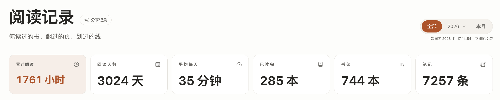
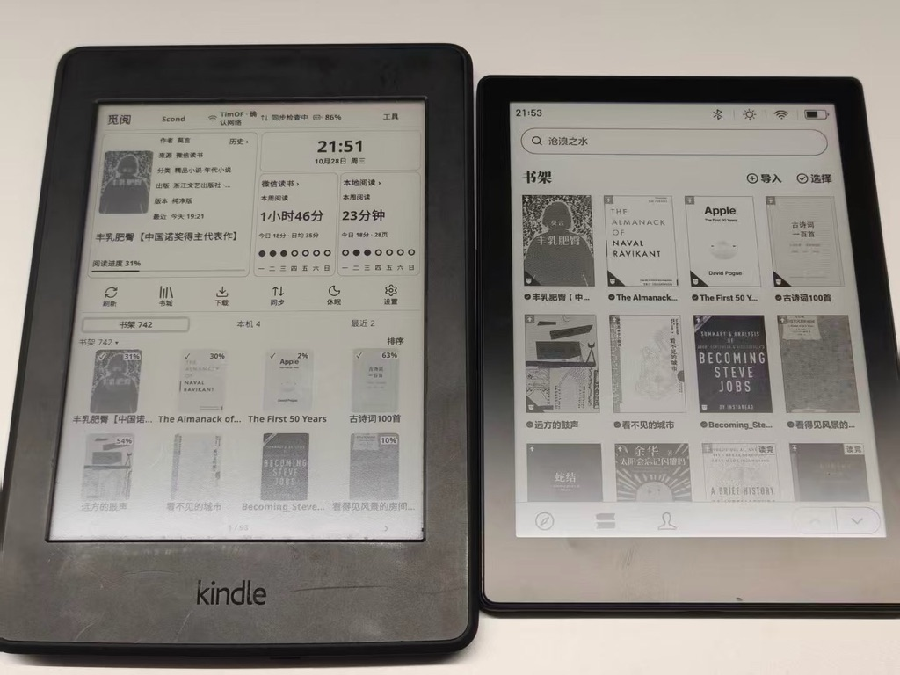
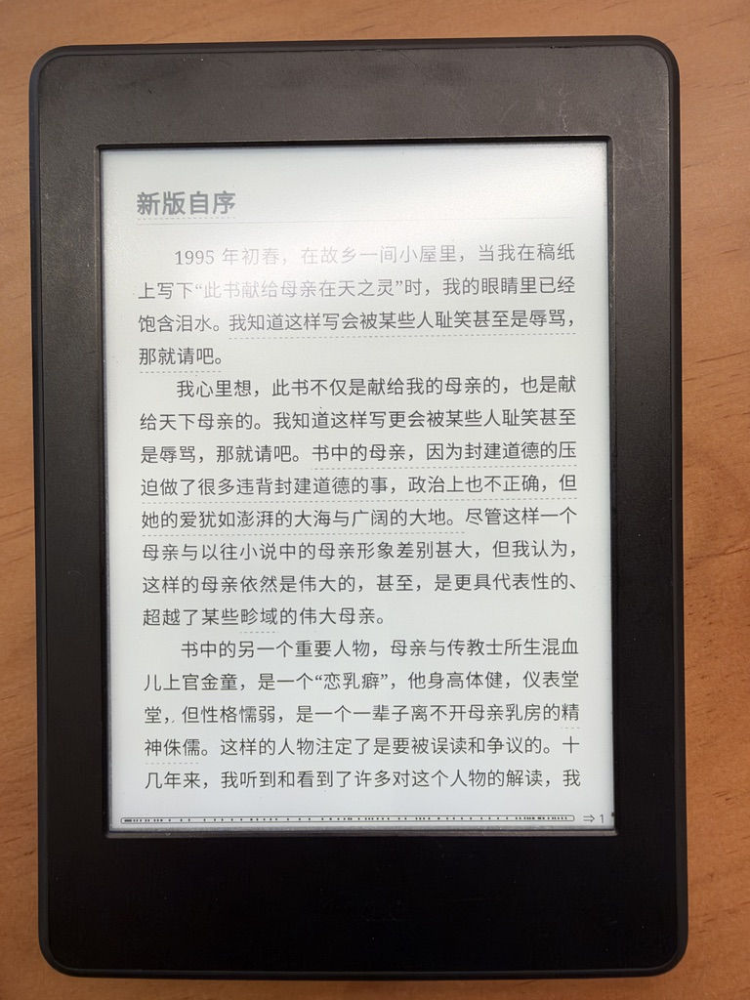
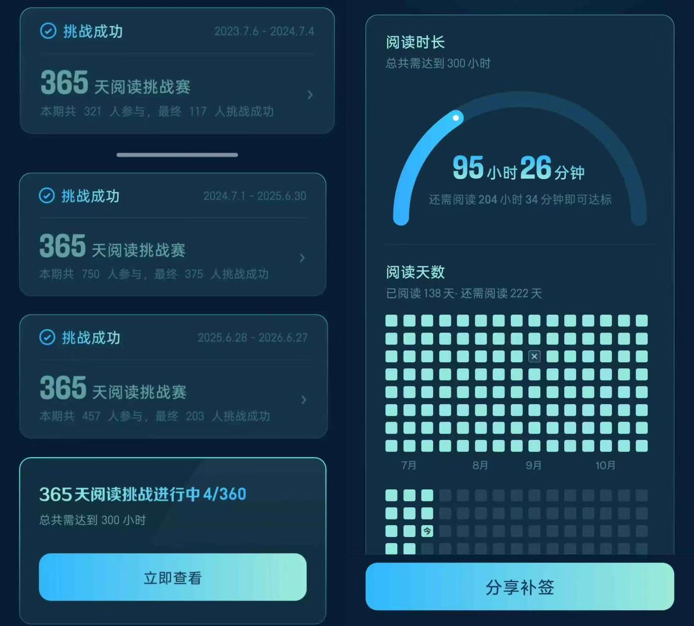
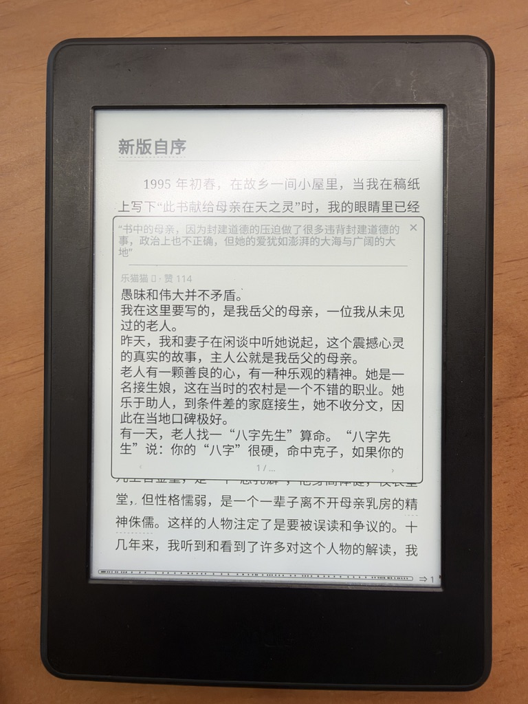
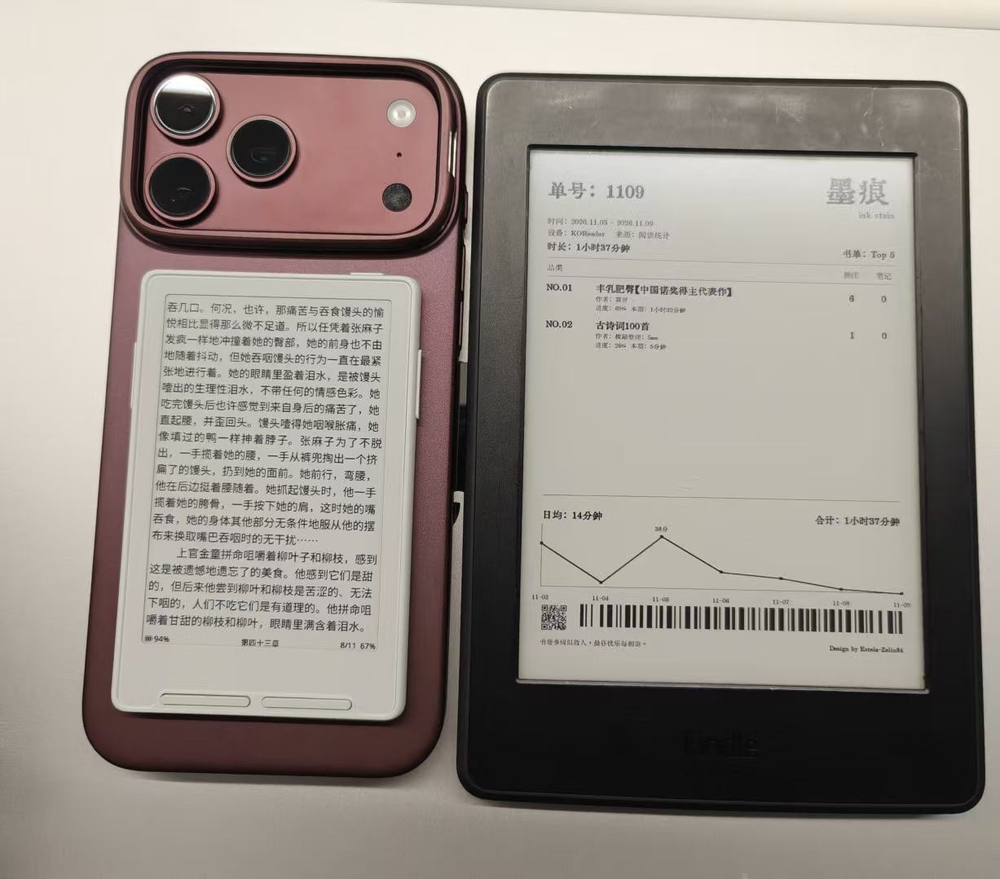
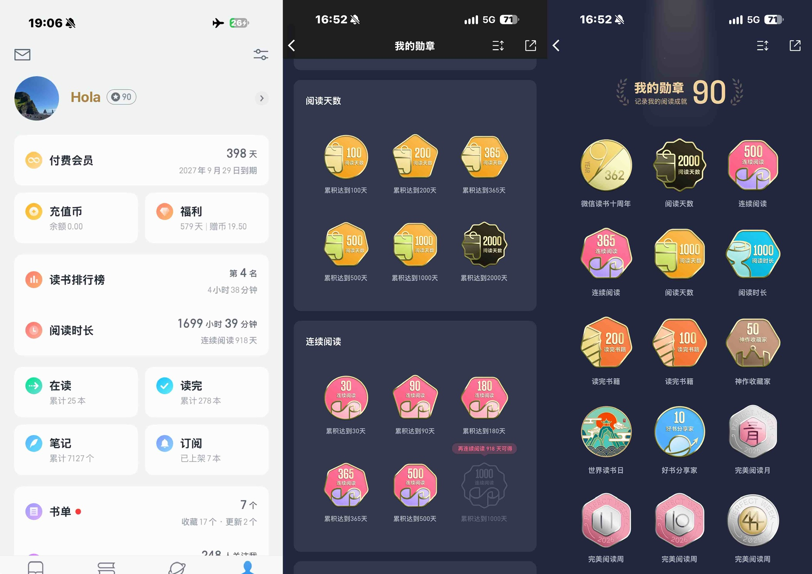

打开我的读书主页，显示我使用微信读书已经3024天，累计1761小时，读完285本，日均35分钟，留下了7257条笔记

最近几年，我已经变成了微信读书的重度爱好者，去年花了999元购买了微信读书官方墨水屏。自从上个月越狱kindle后，我觉得在阅读这件事上，最适合我的搭配就是硬件选择kindle，软件选择微信读书了

左：Kindle Paperwhite 3；右：微信读书墨水屏

**1. 硬件为什么选择kindle**

2016年，花了959元，入手了这款Kindle Paperwhite 3，十年后的今天，装上微信读书，每次拿着它读书，都有一种难以言说的愉悦感：屏幕看起来偏暖，文字细腻，读起来有纸质书的感觉。打开就能接着读，翻页也没什么卡顿。一台大部分时间都在吃灰的老设备，十年后又满足了我现在的阅读需求，属于意外之喜

而它的配置：6英寸，205g，内置阅读灯，300ppi，放到今天，对我读书来说也够用了。对于续航，10年大部分时间吃灰，越狱后使用了半个多月，按照我日均阅读1个小时来说，一个星期都不用充电，甚至比手上的微信读书墨水屏表现还要好

另外，我喜欢kindle的简单，less is more，它没有过多繁杂的功能。我需要的就是一台打开就能阅读的墨水屏，不需要其他乱七八糟的功能。越狱后，它也完美符合了这个条件

如果考虑到这是一台10年前的设备，在闲鱼二手大概200～400可以买到，越狱后，翻页几乎没有卡顿，续航也无可挑剔，如果让我重新选择，我绝对不会去购买手上这台999元的阅读器了，即使新设备在翻页速度和轻薄程度上更好，但这台旧kindle也已经满足了我的需求

**2. 软件为什么选择微信读书**

我觉得微信读书是这么多年以来，微信最有良心的一款产品。
虽然kindle 2023年退出中国，我也依然配置了zlib一键推送图书到kindle，就阅读体验来说，还是微信读书更好

首先，正版书，阅读成本也低。一开始的推广期，微信阅读几乎是免费读书，相比而言，zlib的书籍的质量和排版参差不齐，还是挺影响体验的。直到今天，参加一些打卡活动，就可以获得书币和会员卡。我每年会参加365天阅读挑战，交50块钱，完成规定的阅读天数和时长后，可以获得1张年卡，已经连续参加了4年。即使不参加任何活动，购买年卡，也只要168元，相比购买纸质书，这个价格还是很良心的

然后就是书友互动。支持查看书友的划线和评论分享，做社交和传播，这一点确实是腾讯的强项。有时候读到一段有感触的句子，发现也有不少书友划线，大家虽然都不相识，但是产生了共鸣。而遇到一些不懂的地方，也会有热心书友互动解答。一开始，我还会打开热门划线和评论功能，但是现在我基本上默认关掉，因为我喜欢沉静式阅读，如果看到有划线，会忍不住去看评论，还挺影响自己的阅读节奏和独立思考的能力

多端同步的体验。当你有多设备的时候，就能感受到微信读书的好处了。我经常会在墨水屏、iPhone、安卓手机，有时甚至是电脑上切换着阅读，所有设备自动同步进度，而且体验做的很流畅丝滑，这一点很重要

最后，阅读数据和勋章功能。微信读书有更详细的阅读数据的展示，特别是开放微信读书skill后，可以更全面的了解自己的阅读习惯，比如我用它搭建read.scond.me网站，可以每天自动同步更新阅读数据。而勋章的作用，更多的是激励作用，比如连续阅读、读书时长。目前我已经拿到了“阅读2000天”的勋章，但最难的是连续阅读1000天的勋章，本来按计划，今年就可以拿到了，但是8月份去欧洲旅行，时差原因，有一天忘记了阅读，在第918天的时候中断了，目前又要重新开始了，今天发现，离目标也是相差918天，滑稽了。。。

左：中断前；中：现在的进度

所以，到了2026年的今天，如果需要选择一台设备，来满足我的阅读需求，我觉得越狱之后的kindle，是最佳的选择，可能没有之一

最后，作为微信读书的重度使用者，最近我也在做一款辅助微信读书的App，方便自己查看微信读书的阅读趋势和数据，也不让做过的笔记一直沉睡

如果你也有类似的需求，可以在公众号后台回复“阅读”，参与一起讨论和测试

\*原文链接：[读书，为什么硬件我选kindle，软件选择微信读书](https://mp.weixin.qq.com/s/4yXmnewMYhJvD1zb19I3nA)
{: .post-source }

---

**关于我**  
旅行、跑步、看书，也喜欢 AI 和数码

🌍 30+ 国家 · 🏅 半马 1h36 ｜ 全马 3h58

[主页 scond.me](https://scond.me)

