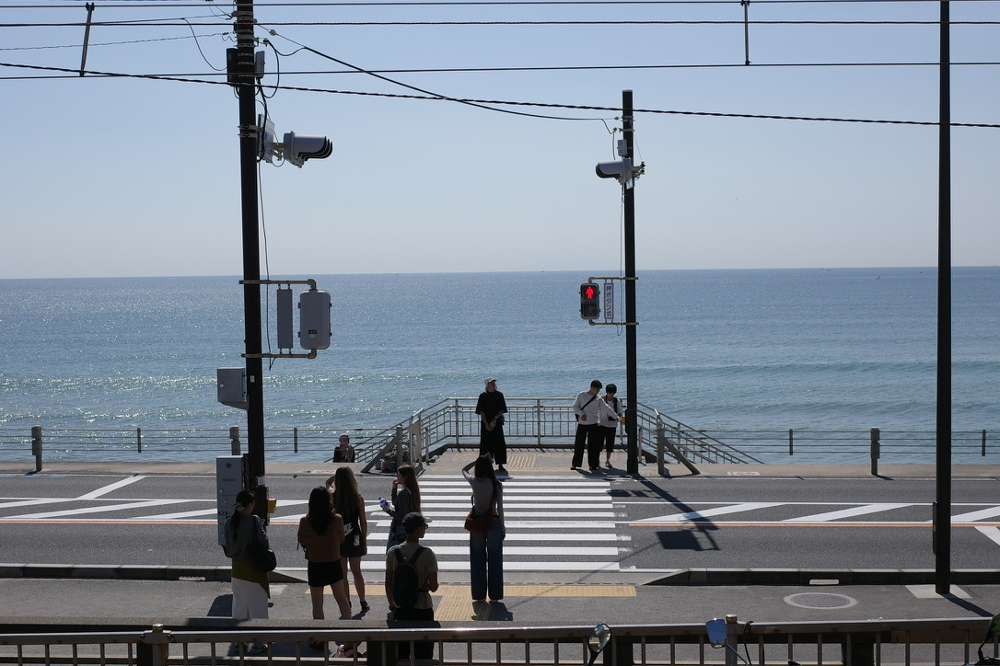
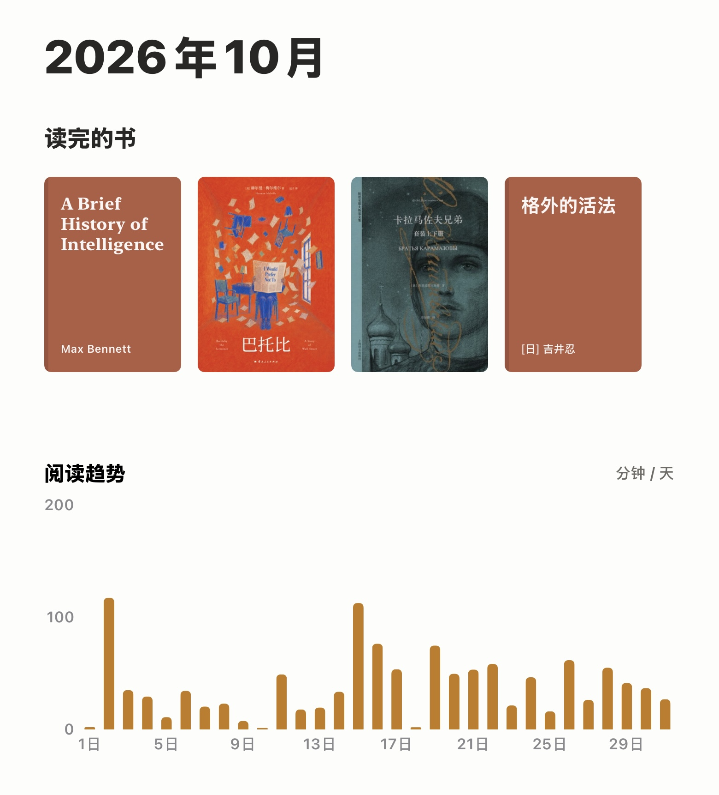
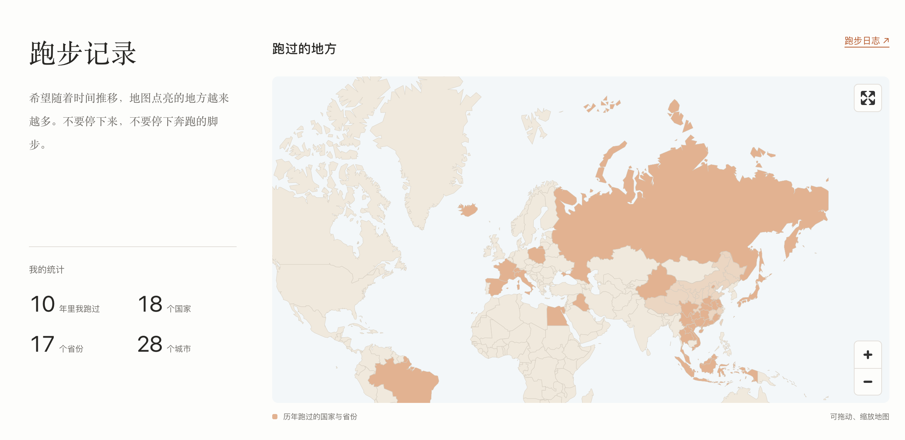

11月都快过去了，10月份的复盘躺在草稿箱很久，想了想还是发出来

1. 旅行

国庆假期，去日本旅行了10天，东京、富士山、伊豆、镰仓。这次出发之前，读完了2本关于日本的书籍，旅途中，所见所闻，对这个国家有了更深入的了解和认知。日本是我去过的国家里，少有的充满秩序和文明，以及对个人的尊重的国度

在东京，原本只是站在一家烧鸟店门外拍照，一位刚吃完饭的客人建议我们进去试试。点餐时，左边的年轻人打开 Google 翻译帮我们推荐，离开时，斜对面的一对夫妇还朝我们挥手

河口湖那天，在湖边餐厅等到下午3点，也没看到完整的富士山。回去的时候沿着湖岸从天亮走到天黑，反倒成了当天最意外的收获

这些记忆，让人难忘

2. 写作

这个月，周末，大量时间都坐在咖啡店，密集更新文章，竟然写了10篇。既有自己喜欢的数码产品的使用体验，也有游记攻略，以及kindle越狱教程，也收获了2篇爆款，《体验了 iPhone Duo，回来就取消了预订单》单篇9.7万，《十年前的 Kindle，用 AI 装上微信读书后，又成了主力》这篇10万+

| 日期    | 文章                                                                                                                                                                                                                                                   |
| ----- | ---------------------------------------------------------------------------------------------------------------------------------------------------------------------------------------------------------------------------------------------------- |
| 10/01 | [Apple Watch 和佳明双持一年后，我为什么不再戴佳明了](https://blog.scond.me/2026/10/01/Apple-Watch-%E5%92%8C%E4%BD%B3%E6%98%8E%E5%8F%8C%E6%8C%81%E4%B8%80%E5%B9%B4%E5%90%8E-%E6%88%91%E4%B8%BA%E4%BB%80%E4%B9%88%E4%B8%8D%E5%86%8D%E6%88%B4%E4%BD%B3%E6%98%8E%E4%BA%86/) |
| 10/14 | [全飞秒手术，反复模糊一年多，终于看清了](https://blog.scond.me/2026/10/14/%E5%85%A8%E9%A3%9E%E7%A7%92%E6%89%8B%E6%9C%AF-%E5%8F%8D%E5%A4%8D%E6%A8%A1%E7%B3%8A%E4%B8%80%E5%B9%B4%E5%A4%9A-%E7%BB%88%E4%BA%8E%E7%9C%8B%E6%B8%85%E4%BA%86/)                                 |
| 10/19 | [0现金，8807元，日本国庆十日游](https://blog.scond.me/2026/10/19/0%E7%8E%B0%E9%87%91-8807%E5%85%83-%E6%97%A5%E6%9C%AC%E5%9B%BD%E5%BA%86%E5%8D%81%E6%97%A5%E6%B8%B8/)                                                                                             |
| 10/24 | [0现金、8807元，日本10日游抄作业版](https://blog.scond.me/2026/10/24/0%E7%8E%B0%E9%87%91-8807%E5%85%83-%E6%97%A5%E6%9C%AC10%E6%97%A5%E6%B8%B8%E6%8A%84%E4%BD%9C%E4%B8%9A%E7%89%88/)                                                                               |
| 10/25 | [体验了 iPhone Duo，回来就取消了预订单](https://blog.scond.me/2026/10/25/%E4%BD%93%E9%AA%8C%E4%BA%86-iPhone-Duo-%E5%9B%9E%E6%9D%A5%E5%B0%B1%E5%8F%96%E6%B6%88%E4%BA%86%E9%A2%84%E8%AE%A2%E5%8D%95v2-0/)                                                           |
| 10/28 | [退订iPhone Duo之后，一个果粉的折叠屏使用感受](https://blog.scond.me/2026/10/28/%E9%80%80%E8%AE%A2iPhone-Duo%E4%B9%8B%E5%90%8E-%E4%B8%80%E4%B8%AA%E6%9E%9C%E7%B2%89%E7%9A%84%E6%8A%98%E5%8F%A0%E5%B1%8F%E4%BD%BF%E7%94%A8%E6%84%9F%E5%8F%97/)                         |
| 10/29 | [Kindle 越狱与微信读书安装教程](https://blog.scond.me/2026/10/29/Kindle-%E8%B6%8A%E7%8B%B1%E4%B8%8E%E5%BE%AE%E4%BF%A1%E8%AF%BB%E4%B9%A6%E5%AE%89%E8%A3%85%E6%95%99%E7%A8%8B/)                                                                                   |
| 10/29 | [十年前的 Kindle，用 AI 装上微信读书后，又成了主力](https://blog.scond.me/2026/10/29/%E5%8D%81%E5%B9%B4%E5%89%8D%E7%9A%84-Kindle-%E7%94%A8-AI-%E8%A3%85%E4%B8%8A%E5%BE%AE%E4%BF%A1%E8%AF%BB%E4%B9%A6%E5%90%8E-%E5%8F%88%E6%88%90%E4%BA%86%E4%B8%BB%E5%8A%9B/)           |
| 10/31 | [国产电视安装 Aerial 超详细教程](https://blog.scond.me/2026/10/31/%E5%9B%BD%E4%BA%A7%E7%94%B5%E8%A7%86%E5%AE%89%E8%A3%85-Aerial-%E8%B6%85%E8%AF%A6%E7%BB%86%E6%95%99%E7%A8%8B/)                                                                                 |
| 10/31 | [用AI花了10分钟，小米电视终于清爽了](https://blog.scond.me/2026/10/31/%E7%94%A8AI%E8%8A%B1%E4%BA%8610%E5%88%86%E9%92%9F-%E5%B0%8F%E7%B1%B3%E7%94%B5%E8%A7%86%E7%BB%88%E4%BA%8E%E6%B8%85%E7%88%BD%E4%BA%86/)                                                         |

3. 健康

30天平均心情3.29（上个月3.23），早睡率85%（上个月80%）
跑步45km，相比上个月80.8km，少了35.8km，俯卧撑473次，上个月410次
这个月跑得少了，主要是因为出去旅行了，身体偶尔也不太舒服

apple watch的数据丢给AI，相比9月，没什么太大变化

| 每日指标均值    |        9月 |           10月 |
| --------- | --------: | ------------: |
| 睡眠        |    7小时15分 |    **7小时02分** |
| 静息心率      | 46.96 bpm | **46.37 bpm** |
| HRV（SDNN） |  78.11 ms |  **81.51 ms** |
| 步数        |   12,129步 |   **12,846步** |
| 步行不对称     |     1.76% |     **1.86%** |

4. 阅读
10月阅读了19小时49分，日均38分钟，较9月日均减少29%，读完了4本
{: width="343" }

英文版的《A Brief History of Intelligence》，从1月读到10月，花了差不多30个小时。读完最想留下的是文末这句

“We are still at the base of the mountain, only on the fifth step on a long staircase to something”

都走到今天了，可能还只是在山脚。想到这里，对接下来，AI能带来什么，充满期待

《卡拉马佐夫兄弟》，花了26个小时，但是我中间读错了情节，导致觉得这本书一般，这不能怪作家，是我的问题，当然大概率也不会重读了

《格外的活法》，从一些对话和故事中，了解日本的风土人情和文化

本月喜欢的一首诗歌，是杜牧的《江南春》

千里莺啼绿映红，水村山郭酒旗风。
==南朝四百八十寺，多少楼台烟雨中。==

5. AI

重构了个人主页scond.me，特别是我的跑步网站run.scond.me

回想23年，0编程经验，靠着初代ChatGPT+网上找攻略，复刻开源大V yihong老师的网站，那时候连fork都不知道什么意思。完成网站的更新后，在群里给他留言表示感谢。他说“应该的，3年过去了，你还在跑，才让地图更漂亮的，牛逼”。是的，当我打开跑步网站，看到越来越密集的轨迹，那种喜悦感，是无以言说的。同时，被陌生人帮助和鼓励的感觉，是美妙的，希望自己以后也可以做到
{: width="422" }

这个月还用AI给十年前的Kindle装上了微信读书，写了篇教程，帮一些陌生人重新用上了自己的Kindle，是这个月最开心的事情了

更新迭代了小程序“拼拼账单”，主要是解决山姆拼单的问题。从0个用户，增长到了1316个，每天竟然都有几块钱的流量收入，很是意外了。当初投入时间和金钱，纯粹就是想试一试，试试毫无经验的我，能否做成一个小程序，完成备案，上架...

6. 影音

这个月最喜欢的播客是半拿铁的《苹果简史》，一共5期，累计有10个多小时。之前读过乔布斯传，自己又是果粉，听这个专辑的时候，很舍不得听完，最后一集，快要结束的时候，刘飞哽咽着结束，很是感动。这也是我第一次给播客打赏

7. 买了什么

给scond.me这个域名续费了2年，花了216，在闲鱼找的卖家，8折。其实还有更便宜的域名，但是不想换了

更新了AirPods 5，卖掉了AirPods 4，算下来差价350左右，苹果产品的保值率真高，但是呢，用了不到一个星期，跑完步放在口袋，给它洗了个澡，第二天早上才发现。在除湿机上拯救了一下，完好

纠结了很久，又升级了ChatGPT的订阅。生产力工具，希望可以帮我实现更多我想做的事情，比如做一些软件和工具，敬请期待

更新了iPhone 18 Pro Max，卖出了17 Pro。要是以前，肯定是没有这么果决的，但是想到马上要过生日了，把钱亏在股市，不如升级生产力工具

8. 投资

巨款亏损，不提了

9. 思考：

> “做时间的朋友，不要焦虑，保持peace，如果今年要给自己留下一句话，我希望是：加油”
> ——10/21

> “不要为了coding而coding”
> ——10/26

> “最关键的是要把它做成一个毫无压力和负担的事情，在不影响生活的节奏的情况下”
> ——10/27，谈写作

好了，以上就是我的月度复盘，立个flag，以后要做到每个月更新

\*原文链接：[26年10月复盘｜“三年过去了，你还在跑”](https://mp.weixin.qq.com/s/glGs56Gw8rFN8w6GztN5Zg)
{: .post-source }
