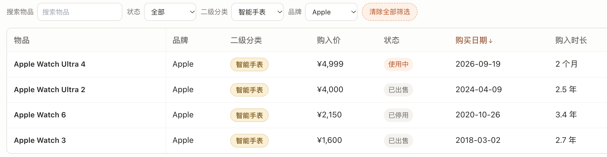
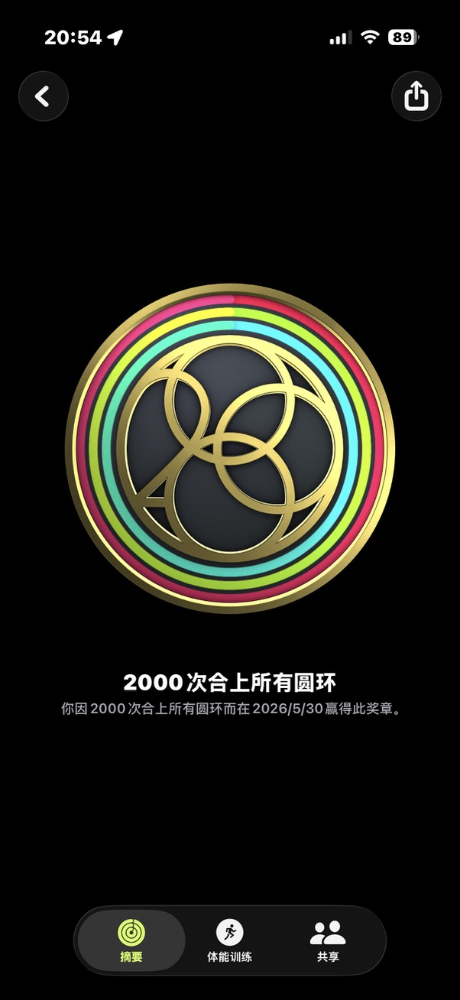
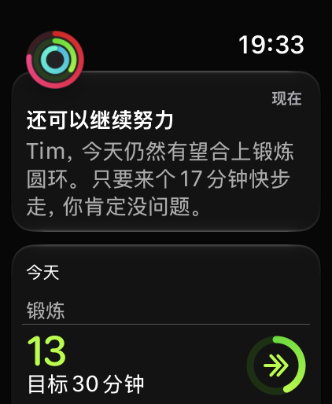
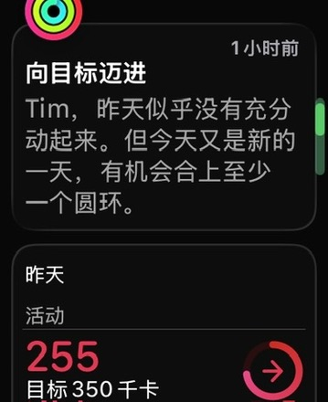
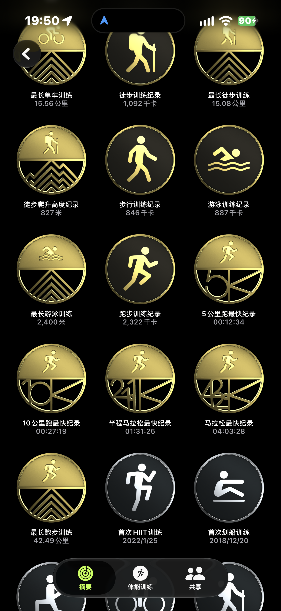
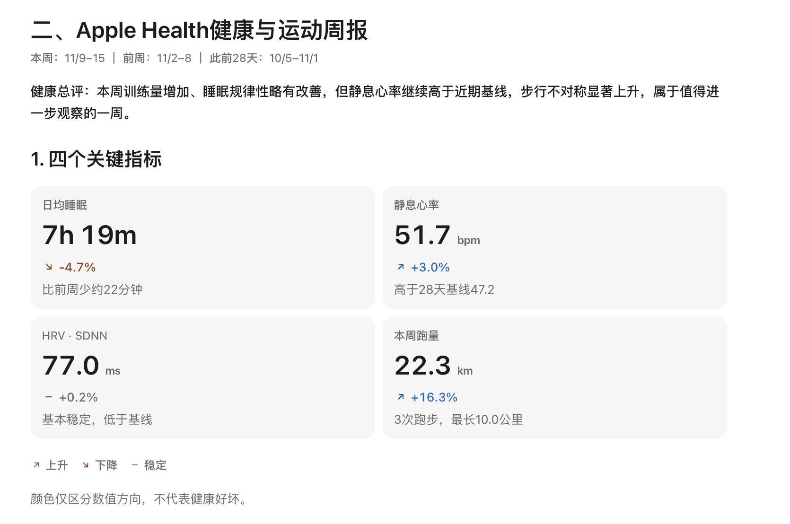
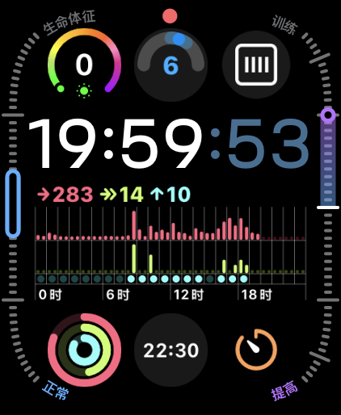
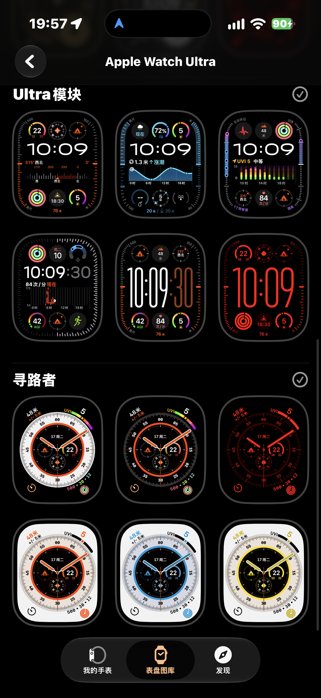
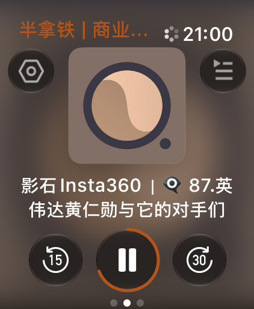
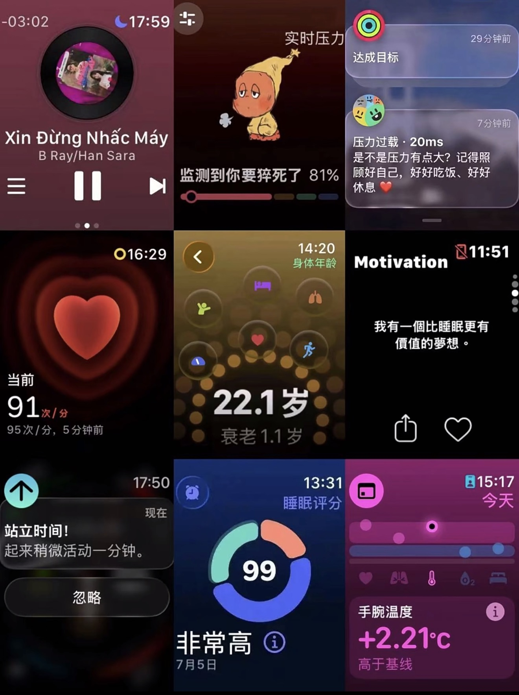

从2018年购买第一块Apple Watch，至今3186天了。这期间，除了洗澡或者充电，无论是运动、睡觉，无时无刻我都戴着它，那么，佩戴智能手表这8年，它对我有什么改变，是否值得呢？我觉得是十分值得，也非常推荐你尝试智能手表

## 1. 运动习惯的养成

每天，Apple Watch都会提醒你完成运动圆环，从Apple Watch购买至今，我的每天目标是：活动350千卡、锻炼30分钟，站立12小时。刚才看了一眼，我已经累计合上所有圆环2144次（当天三个圆环全部合上）

{: width="392" }

最开始，只是为了完成任务，获得勋章，有时候被提醒，就顺便多运动一下。但是慢慢的，这就变成了潜移默化的习惯，我会主动关注今天哪个指标没完成。

而到了傍晚，手表也会主动提示当天运动量不够，无数次，下雨天或者周末的夜晚，我都被这个提醒推出了房间，去户外散步，完成目标；而为了完成12小时站立的任务，白天，每隔1小时，会尽量让自己站起来活动1-2分钟，这也避免了在工位长时间的久坐

{: width="358" }

每个月的第一天，手表会推送一个月度挑战，基于你历史的运动数据，会给你一个需要努力一点才可以达到的目标，比如每个月跑步6次、本月闭合所有圆环16次

是的，就这样，长年累月，它慢慢影响着改变着我的每一天，而我收获了一堆奖章

## 2. 健康监测

每天早晨醒来，我第一件事就是查看手表的睡眠评分。它会通过“睡眠时长”“就寝时间”“中断时间”三个维度，对整个夜晚的睡眠质量打分

如果发现分数持续不足90分，我会调整我的睡眠作息和节奏，也会相应的减少当天的运动量，中午会多午休一会，晚上早点入睡

而最新apple watch ultra 4和12系列，支持“准备指数”功能：它会根据近期运动量、生命体征（心率、呼吸频率、体温、血氧、心率变异性）、睡眠质量，来综合提供每日评分，而且还会实时动态调整分数，对于运动爱好者，可以参考这个评分，来调整自己的运动计划。

如果我发现指数不足5分，就会放弃跑步，选择休息

不止于此，它还支持血氧、心电图、摔倒监测、车祸监测、紧急SOS联络这些功能

## 3. AI+苹果健康数据

当我累计了8年的数据，连接AI之后，我每周会让AI帮我自动生成健康周报，提供下一周的建议。有时候，我还会让AI分析我的某些指标最近几年的变化，比如心率、睡眠。

比如这周我跑了3次，一共22.3公里，但每天平均比前一周少睡了约22分钟...后面我也会单独再写一篇如何用ai来使用苹果健康数据

## 4. 便捷和人性化的功能

**a. 抬起手腕，就可以设置提醒和倒计时，再也不用拿出手机**

作为j人，吃牛肉火锅，我都需要定时涮牛肉，抬起手表”倒计时1min“；丰巢快递总是忘拿，还要交钱“siri，明天提醒我拿快递”，洗了衣服忘记晾“30分钟后提醒我晾衣服”，随时定个闹钟“给我设置一个明早7点的闹钟”，这些小场景，每天使用下来，节约了不少时间

**b. 丰富的免费表盘**

自带大量精美的免费表盘，设置小组件后，抬起手表，一眼可以查看大量的信息。比如现在我使用的表盘：

左侧可以看到我的5个核心指标是否正常（心率、呼吸频率、体温、血氧、心率变异性），右侧可以看到运动负荷是否超标（图中可以看到偏高了）。左上角是实时紫外线系数，中间是身体准备指数，而右上角是支付宝付款码，底部是运动圆环闭合情况，还有下一个闹钟的时间+倒计时工具。当然，这些小组件，都可以自定义，根据自己的需要设置不同的功能

**c. 生态联动**：搭配iPhone，手机的通知会自动流转到手表，无缝切换，非常的丝滑

**d. 设置交通卡和Apple pay**，不用掏手机，可以刷手表乘坐公交，在国外使用Apple pay支付也非常方便

**e. 搭配自带播客或者小宇宙APP**，不带手机，戴着耳机和手表，就可以出门跑步

**f. 没有铃声的闹钟**：当手表设置为静音，手表会通过震动来唤醒你，不会打扰到别人。在早晨起床的时候，更加无感，也不会像闹钟声音那样刺耳，让人不适

当然，它最大的缺点就是续航，数字系列，只能1天左右，ultra系列2-3天，相比一些专业运动手表，确实差了一些。

至于价格，有些人觉得很贵，就我自己的这几年更新迭代来看，旧表可以二手回收，新手表在双11或者618买入，年均持有成本可以做到300～500块钱（我3年以旧换新的计算）。

比如之前的Apple Watch Ultra 2，是花4000块买的。戴了快两年半，最后2650块卖掉，算下来一共花了1350块，平均每个月46块钱。以我每天都戴的频率，再考虑到它给你的健康带来的改变，以及生活的便利性的提升，还是很挺值的

所以，这就是apple watch，一个可以兼顾你的运动、健康，又提升生活品质的产品。

如果说除了手机之外，哪一款数码产品对我最重要，我觉得那就是apple watch了，也强烈推荐你购买一款智能手表，开始关注自己的健康

{: width="534" }

\*原文链接：[02｜Apple Watch：戴了8年，我的使用测评](https://mp.weixin.qq.com/s/saNtg6axEy-Y4QhjlnNKqA?poc_token=HNlOAmujT9A600Ur69vaXalv_CpfpPKK-HghDKM7)
{: .post-source }

---

**关于我**  
旅行、跑步、看书，也喜欢 AI 和数码

🌍 30+ 国家 · 🏅 半马 1h36 ｜ 全马 3h58

🏠 [个人主页](https://scond.me)｜https://scond.me  
📷 [摄影作品](https://scond.me/photography)｜https://scond.me/photography  
🌍 [旅行足迹](https://scond.me/travel)｜https://scond.me/travel  
📚 [阅读记录](https://read.scond.me)｜https://read.scond.me  
🏃 [跑步记录](https://run.scond.me)｜https://run.scond.me

